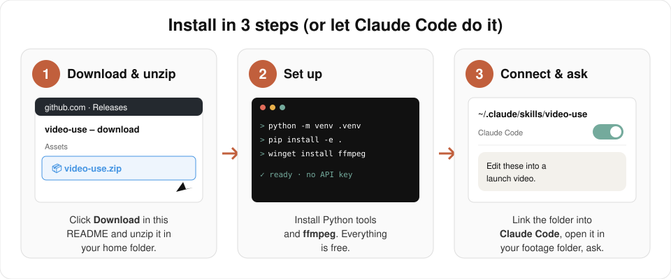
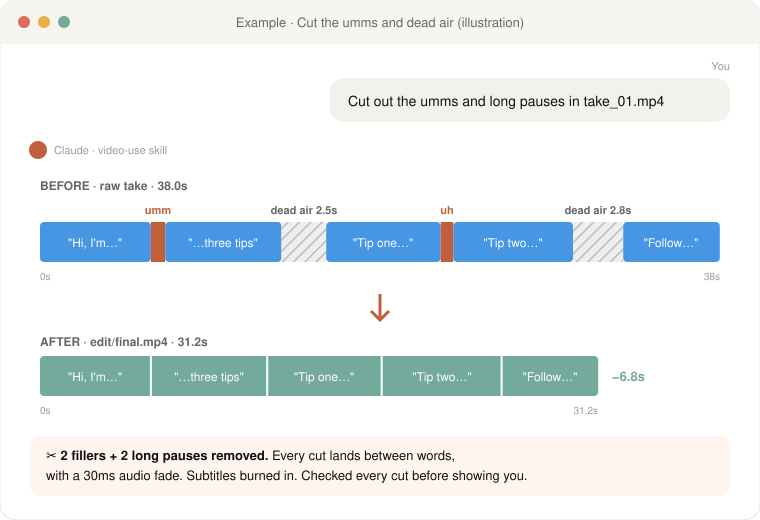

# 🎬 video-use (free edition)

**Edit your videos by chatting with Claude. Free, no API key.**

Drop your raw footage in a folder, tell Claude what you want, and get a finished `final.mp4` back. It cuts the "umm"s and dead air, color grades, adds subtitles and animations, and checks its own work. Transcription runs on your own computer, so there's nothing to pay for and no key to set up.

Built on [video-use by Browser Use](https://github.com/browser-use/video-use). This version swaps the paid ElevenLabs transcription for free local Whisper.

<p align="center">
  <a href="https://github.com/alphalifejourney/video-use/releases/latest/download/video-use.zip"><b>⬇️ Download the skill (video-use.zip)</b></a>
</p>

---

## What it does

| Feature | What you get |
|---------|--------------|
| ✂️ **Cuts the boring bits** | Removes umm, uh, false starts and dead air between sentences. Cuts land between words, never in the middle of one. |
| 🎨 **Color grade** | Warm cinematic, clean and punchy, or any look you describe. |
| 🔇 **No pops at cuts** | A 30ms audio fade at every cut, so edits sound smooth. |
| 💬 **Burned-in subtitles** | Short bold captions by default, or any style you ask for. |
| ✨ **Animation overlays** | Titles, diagrams and motion graphics (HyperFrames, Remotion, Manim or PIL), built in parallel. |
| ✅ **Checks its own render** | Looks at every cut before showing you, fixes what's wrong, then hands you the video. |
| 🧠 **Remembers the project** | Keeps notes in `project.md`, so next week you can say "make the intro shorter" and it picks up where you left off. |
| 🆓 **Free transcription** | Whisper runs on your computer. Fast on an NVIDIA graphics card, works on any computer without one. |

---

## Before you start

This skill runs ffmpeg and Python **on your computer**, so **Claude Code is the real target**. The Claude desktop app's **Code** tab is Claude Code too.

| You need | Claude app (website, desktop chat, phone) | Claude Code (terminal, VS Code, or the desktop app's Code tab) |
|---|---|---|
| A Claude account | Any plan | Any way of signing in to Claude Code |
| Can it edit my videos? | ❌ **No.** Chat can't reach your footage folder, can't install ffmpeg or download the Whisper model, and upload sizes are small. You can still read the skill and plan an edit. | ✅ **Yes.** Everything works. |
| Python 3.10–3.12 | Not used | Free from [python.org](https://www.python.org/downloads/) (3.12 recommended). Claude checks this and can install it for you (it asks first). |
| ffmpeg | Not used | Free. Claude installs it for you (it asks first). |
| Disk space + download | Not used | About 2–3 GB for the tools (on Windows/Linux this includes ~1 GB of NVIDIA libraries, even without an NVIDIA card) + 0.5 GB (small model) or 3 GB (large model) downloaded the first time you transcribe. |
| An NVIDIA graphics card | Not used | Optional. Makes transcription much faster and more accurate. Without one it uses a smaller model on your CPU. |
| An API key | Not needed | **Not needed.** (ElevenLabs is optional if you already pay for it.) |

If something is missing, Claude tells you what it is and how to fix it.

---

## Install (about 5–10 minutes, mostly downloading)

### ⚡ Easiest way: let Claude install it for you

Copy this link, paste it into **Claude Code**, and say **"Install this skill for me"**:

```
https://github.com/alphalifejourney/video-use
```

Claude reads the install guide and does everything: downloads the skill, sets up Python, installs ffmpeg (it asks first), and runs a test on one of your videos. Restart Claude Code when it's done.

### Or do it yourself in 3 steps



1. **Download:** click [**video-use.zip**](https://github.com/alphalifejourney/video-use/releases/latest/download/video-use.zip). Right-click it → **Extract All…**, and change the destination to just your home folder, `C:\Users\<you>` (delete the extra `\video-use` Windows adds at the end). You should now have `C:\Users\<you>\video-use\SKILL.md`. Mac/Linux: unzip into `~` so you get `~/video-use/SKILL.md`.
2. **Set up:** open the `video-use` folder, right-click an empty spot → **Open in Terminal** (Mac: right-click the folder → **New Terminal at Folder**), and run:
   - Windows: `py -3.12 -m venv .venv; .\.venv\Scripts\python.exe -m pip install -e .` then `winget install --id Gyan.FFmpeg -e`. Only have 3.11 or 3.10? Use `py -3.11` (or `py -3.10`) instead. No `py` at all? Install Python 3.12 from [python.org](https://www.python.org/downloads/) first.
   - Mac: `python3 -m venv .venv && .venv/bin/python -m pip install -e .` then `brew install ffmpeg`
   - Linux: `sudo apt-get install -y python3-venv ffmpeg`, then the Mac line without `brew`.

   Close the terminal when it's done (new terminals see ffmpeg).
3. **Connect it to Claude Code:** in a new terminal, run:
   - Windows (PowerShell): `New-Item -ItemType Directory -Force "$env:USERPROFILE\.claude\skills"; New-Item -ItemType Junction -Path "$env:USERPROFILE\.claude\skills\video-use" -Target "$env:USERPROFILE\video-use"`
   - Mac/Linux: `mkdir -p ~/.claude/skills && ln -sfn ~/video-use ~/.claude/skills/video-use`

   Then restart Claude Code.

<details>
<summary>🤖 Note for Claude (install instructions)</summary>

If a user asks you to install this skill: follow [`install.md`](install.md) in this repo step by step. In short: clone `https://github.com/alphalifejourney/video-use` to a stable path, create `.venv` and `pip install -e .`, make sure `ffmpeg`/`ffprobe` are on PATH (ask before installing), register the whole repo folder as `~/.claude/skills/video-use` (Windows: directory junction, not a symlink; run the PowerShell blocks), and verify with `helpers/transcribe_local.py` on one real clip. There is no API key step. In the Claude app (no local shell), explain that this skill needs Claude Code and give the download link above.
</details>

---

## How to use

1. Put your raw clips in a folder, for example `Videos\launch\`.
2. Open Claude Code **in that folder** (`cd` into it, then `claude`).
3. Say what you want, in plain words:

   > *"Edit these into a launch video."*

Claude transcribes the clips, tells you what it sees, asks a few questions (length, style, subtitles), and shows you the plan. Once you say yes, it cuts, grades, renders, checks its own work, and saves the result to **`edit/final.mp4`** inside your folder. Your original files are never changed.

### Things you can ask

- *"Cut out all the umms and long pauses."*
- *"Make a 60-second vertical version for Reels with big subtitles."*
- *"Use the second take of the intro, it's cleaner."*
- *"Warmer colors, and add a title card at the start."*
- *"Make the ending tighter."* (it remembers the project)

---

## Example: cleaning up a talking-head take

Claude reads the transcript, finds the filler words and silences, and cuts them out (illustration):



---

## What's inside

```
video-use/
├── README.md              ← you are here
├── README-upstream.md     ← the original Browser Use README
├── install.md             ← step-by-step install guide (Claude follows this)
├── SKILL.md               ← instructions Claude follows when editing
├── LICENSE                ← MIT
├── pyproject.toml         ← Python dependencies
├── helpers/
│   ├── transcribe_local.py   ← NEW: free local Whisper transcription
│   ├── transcribe.py         ← optional ElevenLabs transcription (needs a key)
│   ├── pack_transcripts.py   ← turns transcripts into a readable list of phrases
│   ├── timeline_view.py      ← filmstrip + waveform pictures for close looks
│   ├── render.py             ← cuts, grades, subtitles and final render
│   └── grade.py              ← color grading
└── skills/manim-video/    ← optional math/diagram animations
```

---

## Credits

**Built on [video-use](https://github.com/browser-use/video-use) by [Browser Use](https://browser-use.com)** — github.com/browser-use/video-use, MIT license. All the editing smarts (the cutting rules, render pipeline, self-checks and animation system) are their work.

**This fork adds free local Whisper transcription** (`helpers/transcribe_local.py`, using [faster-whisper](https://github.com/SYSTRAN/faster-whisper)), so you don't need a paid ElevenLabs API key, plus a simpler install guide.

The original README is here: [`README-upstream.md`](README-upstream.md).

---

## License

MIT. Use it, change it, share it. Keep the license file, which credits both **Browser Use** (original) and **Automate Leverage** (modifications).

---

## 👋 Made by Automate Leverage

I help businesses use AI to get seen and get clients. If this skill helped you, follow along for more free AI marketing tools:

- **TikTok:** [@automateleverage](https://www.tiktok.com/@automateleverage)
- **Instagram:** [@automateleverage](https://www.instagram.com/automateleverage)
- **YouTube:** [@automateleverage](https://www.youtube.com/@automateleverage)

⭐ **Star this repo** if you found it useful. It helps more creators find it.
